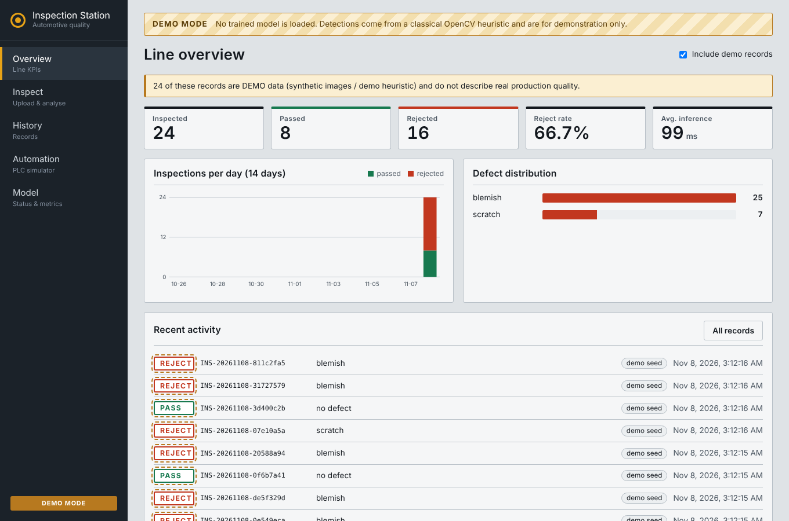
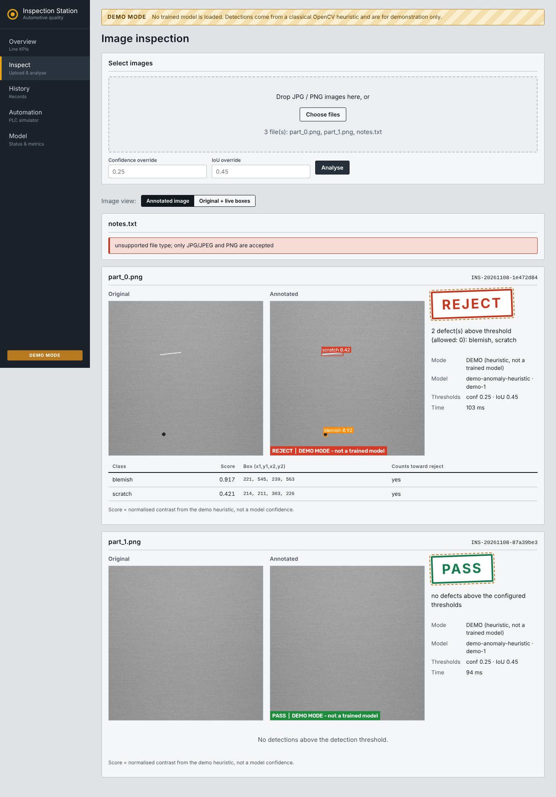
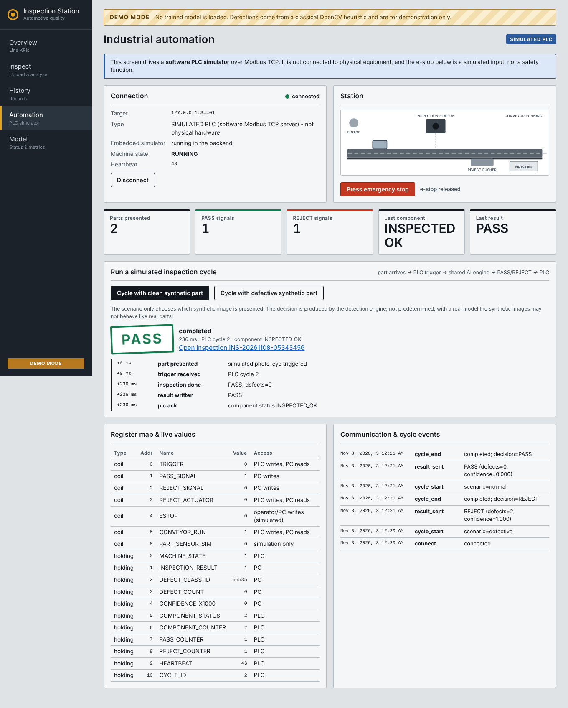
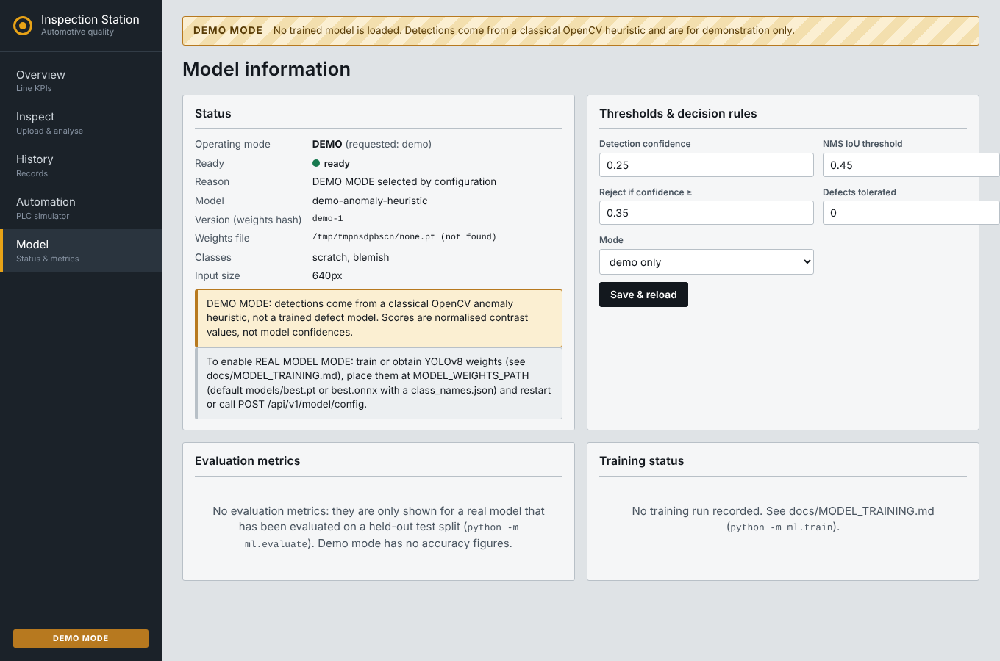
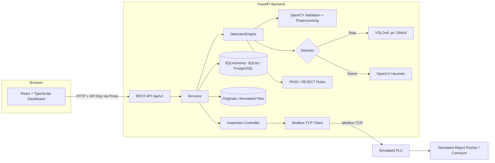

# Smart Automotive Quality Inspection Platform

An end-to-end software prototype for automated surface-defect inspection and simulated production-line automation.

One codebase, two independently demonstrable projects that share a single detection engine:

- **Project A – AI Defect Detection:** Upload images → OpenCV validation and preprocessing → YOLOv8 or demo heuristic → PASS/REJECT decision → annotated image → SQL record → dashboard.
- **Project B – PLC-Integrated Inspection:** A software PLC simulator communicates over Modbus TCP. A simulated part arrives, the PLC raises a trigger, the platform inspects the image using the same detection engine, writes the result registers and PASS/REJECT coil, and the PLC logic actuates a simulated reject pusher.

> **Important project limitations**
>
> - The PLC is a **software simulator**, not a physical PLC. The emergency-stop input is simulated and is not a certified safety function.
> - No trained defect model or dataset is bundled with this repository. Without trained weights, the application runs in clearly labelled **DEMO MODE**, using a classical OpenCV anomaly heuristic on synthetic images.
> - Demo detections are not trained-model predictions and must not be interpreted as model accuracy.
> - Model evaluation metrics are separate from demo-mode results. They should only be treated as model metrics when generated by the evaluation script on a held-out dataset for the corresponding weights.
> - The trained weights and datasets are not committed to this repository.
> - See `BUILD_REPORT.md` and `TEST_REPORT.md` for the verification scope and known limitations.

## Screenshots



*Screenshots in `docs/screenshots/` show the dashboard in DEMO MODE. The original offline build environment did not have FastAPI available, so a temporary stand-in HTTP server was used for the captures. See `TEST_REPORT.md` for details.*

| Inspection | Automation (simulated PLC) | Model |
|---|---|---|
|  |  |  |

## Problem Statement

Visual inspection of machined and stamped parts can be slow, subjective, and difficult to trace.

An object detector can identify potential surface defects such as scratches, pits, and inclusions. However, a detector alone is not a complete quality-inspection system.

Production inspection also requires configurable acceptance rules, traceable records, annotated inspection results, and a way to communicate decisions to production-line automation.

This project demonstrates that complete software workflow at prototype scale.

## Features

### AI defect detection

- JPG/PNG image upload with file-type validation, size and pixel-count limits, and corrupt-file handling.
- Original images stored separately from annotated outputs.
- Shared `DetectionEngine` supporting three detection backends:
  - Ultralytics YOLOv8 `.pt`
  - ONNX Runtime `.onnx`
  - OpenCV-based demo heuristic
- Configurable confidence and IoU thresholds.
- Class-aware Non-Maximum Suppression (NMS).
- Configurable PASS/REJECT rules, including per-class thresholds, minimum defect area, and tolerated defect count.
- Inspection history and database records.

### Dataset and model tooling

- YOLO dataset validation, including class IDs, bounding-box ranges, orphan labels, and leakage checks.
- Leak-free stratified dataset splitting.
- VOC-to-YOLO conversion for NEU-DET-format annotations.
- Synthetic demo dataset generation for pipeline testing.
- Model training, evaluation, inference, and ONNX-export scripts.
- Evaluation metrics: precision, recall, F1, mAP50, mAP50-95, and confusion matrix.

### PLC-integrated automation

- Modbus TCP software PLC simulator.
- Modbus client with timeouts, retries, back-off, and reconnection handling.
- Trigger-based inspection using the shared detection engine.
- PASS/REJECT output and simulated reject-pusher logic.
- Register map and event logging.
- Watchdog with fail-safe reject behaviour.
- Simulated emergency-stop input and documented safety limitations.

### Application and infrastructure

- FastAPI backend.
- SQLAlchemy persistence with SQLite by default and PostgreSQL support.
- React 19 and TypeScript dashboard.
- Overview, inspection, history, automation, and model screens.
- Docker Compose configuration.
- Nginx frontend configuration.
- Authenticated control endpoints.
- GitHub Actions CI workflow.

## Architecture



More details: `docs/ARCHITECTURE.md`.

## Technology Stack

| Area | Technologies |
|---|---|
| Backend | Python 3.11+, FastAPI, Pydantic v2 |
| Database | SQLAlchemy 2, SQLite, PostgreSQL |
| Computer Vision | OpenCV, NumPy |
| Object Detection | Ultralytics YOLOv8, PyTorch |
| Model Serving | ONNX Runtime |
| Frontend | React 19, TypeScript |
| Frontend Build | esbuild |
| Industrial Communication | Modbus TCP |
| Infrastructure | Docker, Docker Compose, Nginx |
| Testing | pytest, unittest |
| CI | GitHub Actions |

Modbus TCP implementation: `backend/app/plc/`. An optional PyModbus adapter is included; see `docs/PLC_INTEGRATION.md`.

## Quick Start

### Prerequisites

- Python 3.11 or later.
- Node.js and npm for building and serving the frontend.
- Docker and Docker Compose only if using the Docker setup.

### Option 1: Run the scripted demo

The demo runs without starting the web server, but requires the backend Python dependencies.

From the project root:

```bash
python -m pip install -r backend/requirements.txt
python scripts/demo.py
```

To keep generated demo output:

```bash
python scripts/demo.py --keep
```

The demo uses synthetic images and DEMO MODE unless real weights are configured.

### Option 2: Run the full application locally

**Windows PowerShell:**

```powershell
.\scripts\run_local.ps1
```

**Linux/macOS:**

```bash
./scripts/run_local.sh
```

The local-run script:

1. Creates a `.venv` virtual environment if one does not exist.
2. Installs `backend/requirements.txt`.
3. Builds the frontend if `frontend/dist/index.html` is missing and npm is available.
4. Starts Uvicorn bound to localhost.

Open:

- Dashboard: http://127.0.0.1:8000
- API documentation: http://127.0.0.1:8000/docs

State-changing endpoints accept loopback clients without an API key. This is intended for local development, not public deployment.

### Option 3: Run with Docker Compose

Create a local environment file:

```bash
cp .env.example .env
```

Set `API_KEY` to a long random value in `.env`, then run:

```bash
docker compose up --build
```

Open the dashboard at:

http://localhost:8080

The Compose configuration includes:

- `backend`
- `plc-simulator` (no published port)
- `frontend` (Nginx, which injects the API key so the browser does not hold it)

## Dataset Setup

See `docs/DATASET_GUIDE.md` for the detailed dataset workflow.

The following commands illustrate the process. Run them from the `backend` directory unless otherwise specified.

### 1. Generate a synthetic dataset

```bash
python -m ml.dataset_tools synthetic \
    --out ../data/datasets/synthetic-demo \
    --count 240
```

Synthetic data is for pipeline testing only. It is not a substitute for a real industrial defect dataset.

### 2. Convert VOC annotations to YOLO format

```bash
python -m ml.dataset_tools voc2yolo \
    --images RAW/IMAGES \
    --annotations RAW/ANNOTATIONS \
    --out RAW_yolo \
    --classes crazing inclusion patches pitted_surface rolled-in_scale scratches
```

Use a NEU-DET dataset that you have obtained yourself.

### 3. Split the dataset

```bash
python -m ml.dataset_tools split \
    --images RAW_yolo/images \
    --labels RAW_yolo/labels \
    --out ../data/datasets/neu-det \
    --classes crazing inclusion patches pitted_surface rolled-in_scale scratches
```

### 4. Validate the dataset

```bash
python -m ml.dataset_tools validate \
    --root ../data/datasets/neu-det
```

Dataset licence and attribution details: `docs/DATASET_GUIDE.md`.

## Model Training and Inference

Training requires the additional dependencies:

```bash
pip install -r requirements-train.txt
```

Run the following commands from the `backend` directory.

### Train

```bash
python -m ml.train \
    --data ../data/datasets/neu-det/data.yaml \
    --epochs 50 \
    --batch 8
```

Training can run on CPU, but may be slow. A compatible GPU is used when available.

### Evaluate

```bash
python -m ml.evaluate \
    --weights ../models/best.pt \
    --data ../data/datasets/neu-det
```

### Export to ONNX

```bash
python -m ml.export_onnx \
    --weights ../models/best.pt
```

ONNX export provides a CPU-friendly inference option without requiring PyTorch for model serving.

### Run inference

```bash
python -m ml.infer path/to/images --mode real
```

For further details, see `docs/MODEL_TRAINING.md`.

**Licence note:** Ultralytics YOLOv8 is distributed under AGPL-3.0. Review its licence obligations before commercial or network-service use.

## Model Evaluation Results

The project includes a held-out evaluation artifact at:

`backend/models/metrics.json`

Recorded experimental baseline:

| Metric | Result |
|---|---:|
| Evaluation images | 180 |
| Ground-truth instances | 409 |
| Precision | 47.88% |
| Recall | 52.57% |
| F1 score | 50.12% |
| mAP@50 | 43.29% |
| mAP@50:95 | 17.14% |

These results represent an **early experimental baseline**, not production-level performance.

Performance varies substantially between defect classes. Some classes have particularly low recall, so the model can miss defects. Further dataset work, model tuning, and validation are required before considering industrial use.

The evaluation artifact and confusion matrix are included as evidence of experimentation. They should not be interpreted as proof of production readiness.

## PLC Simulation

The project includes a software-based Modbus TCP simulator.

To start it independently, run from the `backend` directory:

```bash
python -m app.plc.simulator --port 5020 --auto-interval 0
```

Alternatively, use **Connect to simulator** on the Automation screen. The backend can embed a simulator on loopback.

The simulated workflow demonstrates:

1. A part-arrival trigger.
2. Image inspection using the shared detection engine.
3. PASS/REJECT result generation.
4. Modbus register and coil updates.
5. Simulated reject-pusher logic and counters.

The simulator is not a physical PLC and does not implement certified industrial safety functions.

Register map and integration details: `docs/PLC_INTEGRATION.md`.

## API

Interactive API documentation is available at:

http://127.0.0.1:8000/docs

For endpoint descriptions and request examples, see `docs/API_GUIDE.md`.

## Testing and Verification

The project includes backend tests, frontend checks, and CI configuration.

### Verified in the development environment

- 93 backend tests passed.
- Frontend TypeScript type-check passed.
- Frontend production build passed.

### Verification limitations

The offline build environment did not have all dependencies required to execute the complete FastAPI application, SQLAlchemy integration, Docker images, and CI workflow.

The screenshots were captured using a temporary stand-in HTTP server, not a fully running FastAPI deployment.

See `TEST_REPORT.md` and `BUILD_REPORT.md` for the precise test scope and limitations.

To run tests locally:

**Backend unittest:**

```bash
cd backend
python -m unittest discover -s tests -t . -v
```

**Backend pytest:**

```bash
cd backend
python -m pytest
```

This requires the development dependencies from `requirements-dev.txt`.

**Frontend:**

```bash
cd frontend
npm install
npm run typecheck
npm run build
```

## Repository Structure

```text
smart-automotive-quality-inspection/
│
├── backend/
│   ├── app/
│   │   ├── core/
│   │   ├── services/
│   │   ├── api/
│   │   └── plc/
│   ├── ml/
│   ├── tests/
│   └── models/
│       ├── metrics.json
│       └── confusion_matrix.png
│
├── frontend/
│   ├── src/
│   ├── package.json
│   └── build.mjs
│
├── models/
│   └── README.md
│
├── data/
├── docs/
│   ├── screenshots/
│   ├── ARCHITECTURE.md
│   ├── API_GUIDE.md
│   ├── DATASET_GUIDE.md
│   ├── MODEL_TRAINING.md
│   └── PLC_INTEGRATION.md
│
├── scripts/
│   ├── demo.py
│   ├── run_local.ps1
│   └── run_local.sh
│
├── .github/
├── docker-compose.yml
├── .env.example
├── .gitignore
├── BUILD_REPORT.md
├── DEPLOYMENT_CHECKLIST.md
├── PROJECT_OVERVIEW.md
├── TEST_REPORT.md
└── README.md
```

Generated datasets, local databases, virtual environments, node modules, and trained model weights are excluded from Git.

## Deployment

Deployment guidance and limitations:

- `docs/DEPLOYMENT.md`
- `DEPLOYMENT_CHECKLIST.md`

Free hosting tiers may lack persistent disks, long-running workers, and GPU access. Review the deployment constraints before attempting to host the application.

This repository is intended as a portfolio and development prototype, not a production-ready industrial inspection deployment.

## Known Limitations

- No trained model weights or dataset are bundled.
- DEMO MODE uses synthetic images and a classical OpenCV heuristic.
- The experimental model baseline requires further improvement, particularly for classes with low recall.
- The PLC is simulated; no physical PLC or certified safety system is included.
- The screenshots use a temporary stand-in HTTP server because FastAPI could not be installed in the original offline build environment.
- Full FastAPI runtime, SQLAlchemy integration, Docker execution, and CI workflow were not verified in that environment.
- Video and RTSP ingestion are not implemented.
- Authentication uses a shared API key rather than user accounts and role-based permissions.
- PLC communication is Modbus TCP only.

## Future Improvements

- Video and RTSP camera ingestion.
- User accounts and role-based access control.
- Alembic database migrations.
- Improved defect detection and class-wise recall.
- Object segmentation masks.
- Active-learning workflow for reviewing mislabelled or uncertain detections.
- OPC UA and EtherNet/IP adapters.
- Prometheus monitoring and operational metrics.
- Dedicated GPU inference service.

## Licence Notes

No project-code licence is declared by this README alone. Add a `LICENSE` file before publishing if you intend to release the code under a specific licence.

Ultralytics YOLOv8 is licensed under AGPL-3.0. Review the relevant obligations before commercial or network-service use.

Dataset licences belong to their respective owners. See `docs/DATASET_GUIDE.md` for dataset attribution and licence notes.